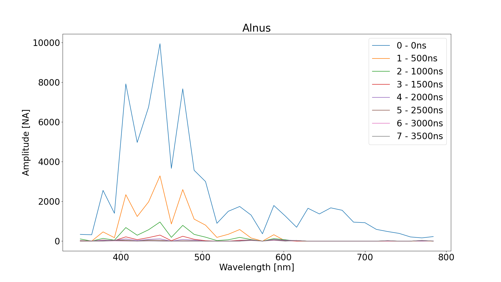
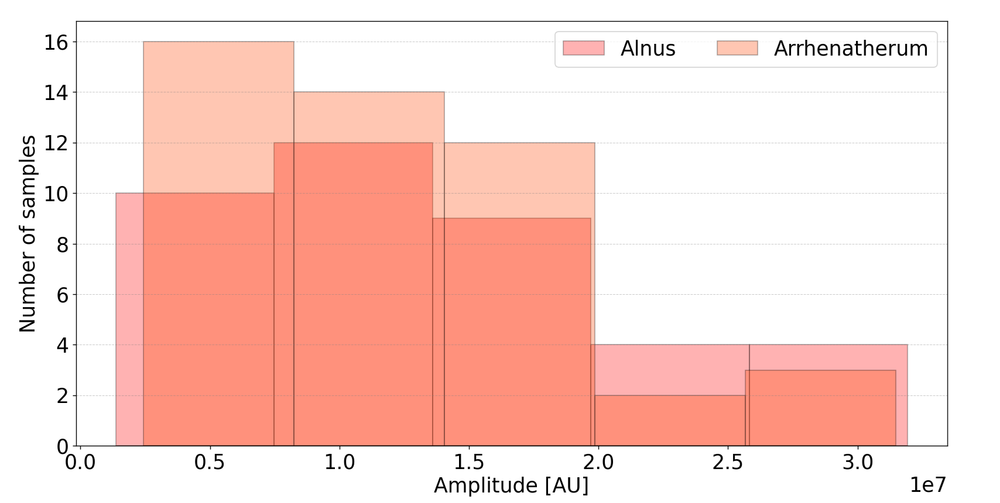

Loading and Preparing Particle Data
===================================

ISEP works with Rapid-E particle measurements. The high-level ``isep``
interface currently provides two inspection tasks and a scaling task.

Available interfaces
--------------------

* ``isep.plot_single_sample``: inspection of an individual sample using
  ``SingleSampleConfig``.
* ``isep.plot_aggregated_samples``: inspection of multiple samples using
  ``MultipleSamplesConfig``.
* ``isep.scale_model_data``: dataset scaling/preparation using
  ``ModelDataScalerConfig``.

Each function and configuration class is listed in
:ref:`python-api-entry-points`.

Single Sample Visualization
---------------------------

Single sample taks allows users to visualize individual particles. By default, three measured by the Rapid-E modalities are available:

* Light scattering
* Florescence lifetime
* Fluorescence spectrum 

These modalities are configured in ``SingleSampleConfig`` through the `scattering_plot`, `lifetime_plot`, and `spectrum_plot`. Each configuration allows users to control whether plot the plot should be displayed using the  `show` option and specify cutoff boundaries to exclude partcles outside the selected range.

The following example displays the scattering plot and saves the output to the dataViewer/out directory.

.. code-block:: python

  import isep
  from isep.configs.singleSample import SingleSamplePlotModel
  from isep.configs import TypesConfig, PathsConfig

  paths_config = PathsConfig(zip_files_rel_path="PKL_Test")
  types_config = TypesConfig(pollen_types=["Alnus", "ArrhinateRum"])
    
  isep.plot_single_sample(
      paths_config,
      types_config,
      plots_save_path="dataViewer/out",
      spectrum_plot=SingleSamplePlotModel(show=True),
      pollen_types_to_show=["Alnus", "ArrhinateRum"]
  )

.. _scattering-aggregated-example:

example output plot should be displayed and saved under the `dataViewer/out` path. 

Multiple Samples Visualization
------------------------------

The multiple samples task allows users to visualize aggregated Rapid-E particle measurements rather than inspecting individual particles. It provides an overview of particle characteristics and helps identify patterns across multiple samples. 

Users can generate visualizations of light scattering, fluorescence lifetime, fluorescence spectrum, and particle size distributions. Additional visualization options include histograms and combined plots.

The available visualization options are configured through `MultipleSamplesConfig`, and the task can be executed using `isep.plot_aggregated_samples()`.

The following example displays the scattering histogram of both investigated particles. It searches the particles directory up tp 5000 particles per class and uses max measurment value for every wavelength as aggregation function.

.. code-block:: python

    import isep
    from isep.configs import TypesConfig, PathsConfig, MultipleSamplesConfig
    from isep.configs.multipleSamples import ScatteringModel, HistogramModel

    paths_config = PathsConfig(zip_files_rel_path="PKL_Test")
    types_config = TypesConfig(pollen_types=["Alnus", "ArrhinateRum"])

    isep.plot_aggregated_samples(
        MultipleSamplesConfig(
            metric_to_process="scattering",
            single_type_count=5000,
            pollen_types=["Alnus", "ArrhinateRum"],
            scattering=ScatteringModel(
                histogram=HistogramModel(
                    plot=True, operation=HistogramModel.MAX_OPERATION, hist_bins=5
                )
            ),
        ),
        paths_config,
        types_config,
    )

On the image below an output is prestented, as number of samples is below 5000 it shows all of the samples it could found and prints a warning i logs.

.. _scattering-example:

Model Data Scaler
-----------------

The scaler determines the minimum and maximum values separately for each selected modality. To do so, it recursively searches user-specified directories for particle files.

Users can fit multiple scalers depending on their needs. For example, different prefiltering methods, specified through the ``filter_rel_path`` parameter, may require separate scalers, as the scaling boundaries can change.

The generated scaler file is required for subsequent steps, such as model training and inference, and **must be created** before performing these tasks. Since scaled data is used during both training and inference, labeled and unlabeled samples can be included when fitting the scaler.

The scaler also generates cache files that can be used for unsupervised training and saves them in a user-defined directory. Due to its specific requirements, supervised training generates its own cache files.

The following example creates a scaler named ``my_scaler`` using particle measurements from the specified directory. The specified prefiltering method is applied before determining the scaling values.

.. code-block:: python

   import isep
   from isep.configs import ModelDataScalerConfig

   isep.scale_model_data(
       ModelDataScalerConfig(
           scaler_name="my_scaler",
           pollen_types_binaries_paths=["PKL_Test"],
           filter_rel_path="common/filters/base_cleanup.py",
       )
   )

Once generated, the scaler can be used in subsequent model training and inference tasks. The same scaler should be used for both training and inference to ensure consistent data normalization.

See :doc:`API Reference <../api_reference>` for the underlying data-processing
implementation.
