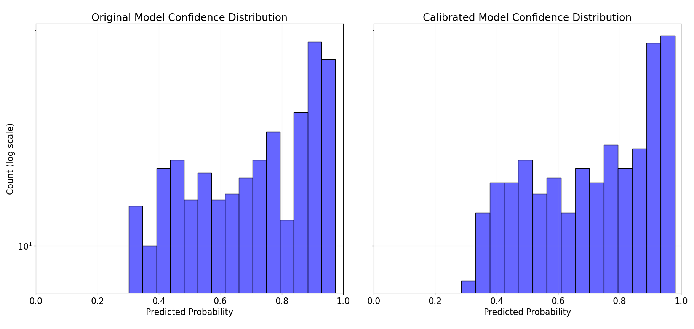
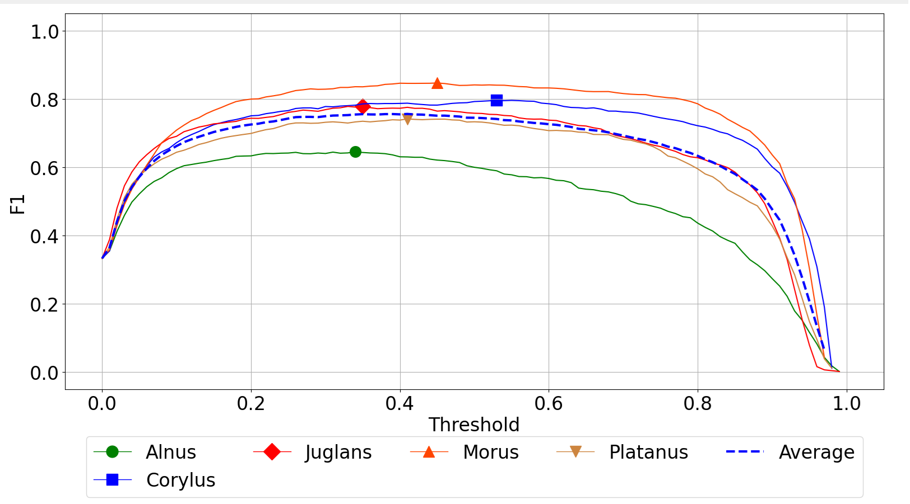
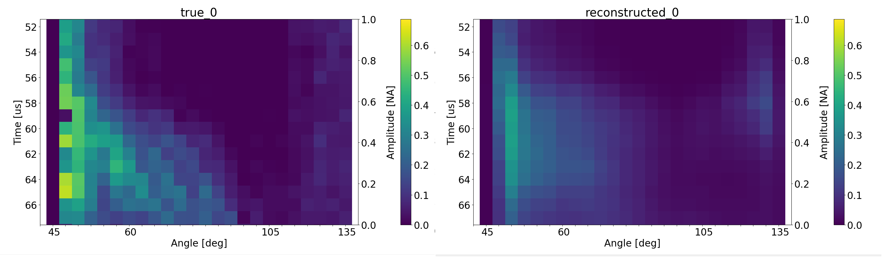
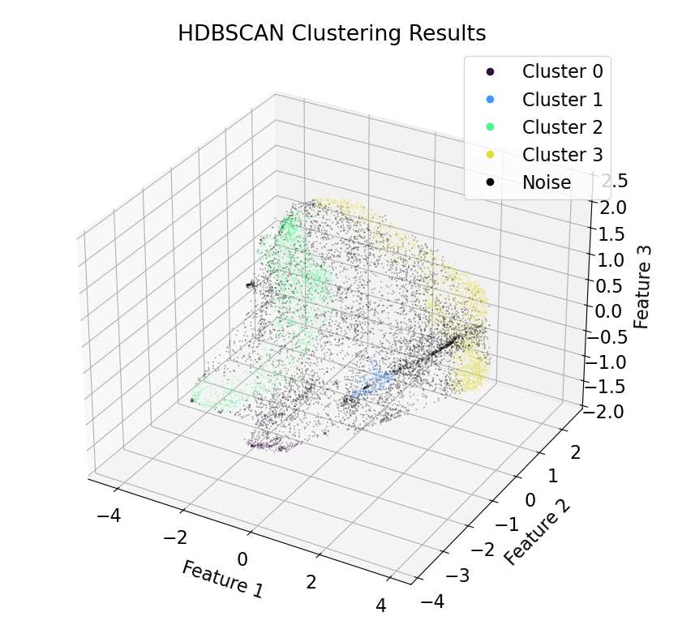

Training Models in Python
=========================

ISEP provides task entry points for supervised convolutional neural network (CNN) training and unsupervised training, including an autoencoder-based workflow. The user-facing functions are ``isep.train_supervised_model`` and ``isep.train_unsupervised_model``.

Fitted scaler described in :doc:`data preprocessing<data_preprocessing>` is required to proceed with this step.

Supervised training
-------------------

Supervised training allows users to train convolutional neural networks (CNNs) for particle classification using labeled Rapid-E measurements. Before starting training, users should prepare labeled particle samples and configure the model  architecture, selected modalities, and training parameters. ISEP allows users to customize the training process, including the number of epochs, batch size, and other training parameters. Additional options include early stopping, learning rate reduction, and model calibration. 

Supervised training module is adapted to process large amounts of data, with use of multiprocessing it reads the input data in parallel, while the data is splitted and saved as *.tfrecord* files, which are adapted to batch reading and high speed read. When the files are saved they refer as cache, causing next program runs highly efficient. As tenserflow library settigns are used the whole dataset only a chunks of data are loaded to memory.

Supervised trainign is divided into three main blocks:

* model training
* model calibration
* model evaluation

to navigate between the tasks different config properties should be set. For example to enable training ``config.run_training`` should be enabled, whereas for model evaluation ``config.summaries.run_summaries``. Similarly calibation is enabled using ``config.calibration.run_calibration`` property.

Model training
~~~~~~~~~~~~~~

Training in ISEP similarly to the machine larning field allows to divide the dataset into training, validation and test samples. Inisde ISEP an additional layer was added called namespace. Within the namespace test set remains constant, which means that different models may use different types of setups, however when it comes to model evaluation all models withing the same namespace will use the same test set. For training fine-tuning most imporant options were extracted to config file, however to modify the neural network the source code is required.

Below is presented sample block of code that allows to train supervised model. It takes ``2000`` samples of every labelled class. With ``OVERSAMPLE_STRATEGY``, training samples of classes that have not reached ``2000`` samples are duplicated; validation and test sets are not oversampled. Additionally, early stopping is enabled to stop the training, if no progress above ``0.05`` was detected for ``2`` consecutive epochs. 

.. code-block:: python

   def handle_supervised_trainer_training():
    import isep
    from isep.configs import SupervisedTrainingConfig
    from isep.configs.supervisedTraining import TrainParametersModel, EarlyStoppingModel

    isep.train_supervised_model(
        SupervisedTrainingConfig(
            model_save_name="model_1",
            test_model_name="model_1_test_model",
            run_training=True,
            train_parameters=TrainParametersModel(
                single_type_count=2000,
                sampling_strategy=TrainParametersModel.OVERSAMPLE_STRATEGY,
                epochs=5,
                early_stopping=EarlyStoppingModel(
                    enabled=True, min_delta=0.05, patience=2
                ),
            ),
            scaler_path="modelBuilder/scaler/base_cleanup/my_scaler.pkl",
        )
    )

Running the task produces output log file showing also live stream in the console. It shows all the necessary progress steps like summary of the trained model architecture, all of the setup and training progress. Such file logs allows to easily navigate between past trainings.

.. code-block:: text
   :class: scrollable-code

   2026-11-11 10:08:26,058 | INFO | Logging in: '<root>\ISEP\resources\modelBuilder\logs\20261111.log'
   2026-11-11 10:08:26,059 | INFO | Python version='3.11.4 | packaged by Anaconda, Inc. | (main, Jul  5 2023, 13:47:18) [MSC v.1916 64 bit (AMD64)]'. (Implemented in 3.11.4)
   2026-11-11 10:08:26,059 | INFO | Current Python interpreter path: 'z:\Miniconda3\envs\myenv\python.exe'
   2026-11-11 10:08:26,059 | INFO | Configs cache on save is NOT invalidated
   2026-11-11 10:08:26,059 | INFO | Keras signbit patched for Windows
   2026-11-11 10:08:26,059 | INFO | Tensorflow version='2.16.1'. (Implemented in 2.16.1)
   2026-11-11 10:08:26,059 | INFO | is_gpu_available: []
   2026-11-11 10:08:26,059 | INFO | is_built_with_cuda=False (vNone). Model training performance may suffer.
   2026-11-11 10:08:26,065 | INFO | Searching for files under path='E:\PKL_Test', types that will be excluded=[]
   2026-11-11 10:08:26,065 | INFO | Train filter not set.
   2026-11-11 10:08:26,065 | INFO | Test filter not set.
   2026-11-11 10:08:26,068 | INFO | (1/2) Cached pollen types file found. Skipping. Path=<root>\ISEP\resources\supervised\cache\model_1_Alnus_train.tfrecord
   2026-11-11 10:08:26,069 | INFO | (2/2) Cached pollen types file found. Skipping. Path=<root>\ISEP\resources\supervised\cache\model_1_ArrhinateRum_train.tfrecord
   2026-11-11 10:08:26,073 | INFO | Input modalities: ['spectrum_unsup', 'lifetime_unsup', 'scattering_unsup', 'size']
   super().__init__(activity_regularizer=activity_regularizer, **kwargs)
   2026-11-11 10:08:26,267 | INFO | Smoothing: 0.1, Learning rate=0.001, Weight decay=0.001
   Model: "functional_4"
   ┏━━━━━━━━━━━━━━━━━━━━━━━━━━━━━━━┳━━━━━━━━━━━━━━━━━━━━━━━━━━━┳━━━━━━━━━━━━━━━━━┳━━━━━━━━━━━━━━━━━━━━━━━━━━━━┓
   ┃ Layer (type)                  ┃ Output Shape              ┃         Param # ┃ Connected to               ┃
   ┡━━━━━━━━━━━━━━━━━━━━━━━━━━━━━━━╇━━━━━━━━━━━━━━━━━━━━━━━━━━━╇━━━━━━━━━━━━━━━━━╇━━━━━━━━━━━━━━━━━━━━━━━━━━━━┩
   │ spectrum_unsup_input          │ (None, 32, 8)             │               0 │ -                          │
   │ (InputLayer)                  │                           │                 │                            │
   ├───────────────────────────────┼───────────────────────────┼─────────────────┼────────────────────────────┤
   │ lifetime_unsup_input          │ (None, 64, 4)             │               0 │ -                          │
   │ (InputLayer)                  │                           │                 │                            │
   ├───────────────────────────────┼───────────────────────────┼─────────────────┼────────────────────────────┤
   │ scattering_unsup_input        │ (None, 120, 24)           │               0 │ -                          │
   │ (InputLayer)                  │                           │                 │                            │
   ├───────────────────────────────┼───────────────────────────┼─────────────────┼────────────────────────────┤
   │ size_input (InputLayer)       │ (None, 1)                 │               0 │ -                          │
   ├───────────────────────────────┼───────────────────────────┼─────────────────┼────────────────────────────┤
   │ spectrum_unsup (Sequential)   │ (None, 64)                │           7,296 │ spectrum_unsup_input[0][0] │
   ├───────────────────────────────┼───────────────────────────┼─────────────────┼────────────────────────────┤
   │ lifetime_unsup (Sequential)   │ (None, 64)                │          39,104 │ lifetime_unsup_input[0][0] │
   ├───────────────────────────────┼───────────────────────────┼─────────────────┼────────────────────────────┤
   │ scattering_unsup (Sequential) │ (None, 64)                │          49,344 │ scattering_unsup_input[0]… │
   ├───────────────────────────────┼───────────────────────────┼─────────────────┼────────────────────────────┤
   │ size (Sequential)             │ (None, 8)                 │              16 │ size_input[0][0]           │
   ├───────────────────────────────┼───────────────────────────┼─────────────────┼────────────────────────────┤
   │ concatenate (Concatenate)     │ (None, 200)               │               0 │ spectrum_unsup[0][0],      │
   │                               │                           │                 │ lifetime_unsup[0][0],      │
   │                               │                           │                 │ scattering_unsup[0][0],    │
   │                               │                           │                 │ size[0][0]                 │
   ├───────────────────────────────┼───────────────────────────┼─────────────────┼────────────────────────────┤
   │ batch_normalization           │ (None, 200)               │             800 │ concatenate[0][0]          │
   │ (BatchNormalization)          │                           │                 │                            │
   ├───────────────────────────────┼───────────────────────────┼─────────────────┼────────────────────────────┤
   │ dense_4 (Dense)               │ (None, 128)               │          25,728 │ batch_normalization[0][0]  │
   ├───────────────────────────────┼───────────────────────────┼─────────────────┼────────────────────────────┤
   │ dropout (Dropout)             │ (None, 128)               │               0 │ dense_4[0][0]              │
   ├───────────────────────────────┼───────────────────────────┼─────────────────┼────────────────────────────┤
   │ logits (Dense)                │ (None, 2)                 │             258 │ dropout[0][0]              │
   ├───────────────────────────────┼───────────────────────────┼─────────────────┼────────────────────────────┤
   │ type_idx_output (Activation)  │ (None, 2)                 │               0 │ logits[0][0]               │
   └───────────────────────────────┴───────────────────────────┴─────────────────┴────────────────────────────┘
   Total params: 122,546 (478.70 KB)
   Trainable params: 122,146 (477.13 KB)
   Non-trainable params: 400 (1.56 KB)
   2026-11-11 10:08:26,617 | INFO | Total samples to train: 59
   2026-11-11 10:08:26,617 | INFO | Sampling strategy: OVERSAMPLE
   2026-11-11 10:08:26,617 | INFO | Class weights: {1: 1, 0: 1}
   2026-11-11 10:08:26,653 | INFO | Buffer size mode is set to ALL_SAMPLES, new buffer_size=59.
   2026-11-11 10:08:26,776 | INFO | Total count for validation set count=13
   2026-11-11 10:08:26,826 | INFO | --------------------------------------------
   2026-11-11 10:08:26,826 | INFO | Epoch 1/5
   2026-11-11 10:08:31,495 | INFO | 1/5 FINISHED - accuracy=0.5254 loss=0.7051 val_accuracy=0.5385 val_loss=0.6927
   2026-11-11 10:08:31,518 | INFO | --------------------------------------------
   2026-11-11 10:08:31,518 | INFO | Epoch 2/5
   2026-11-11 10:08:31,579 | INFO | 2/5 FINISHED - accuracy=0.4915 loss=0.7050 val_accuracy=0.5385 val_loss=0.6918
   2026-11-11 10:08:31,582 | INFO | --------------------------------------------
   2026-11-11 10:08:31,583 | INFO | Epoch 3/5
   2026-11-11 10:08:31,640 | INFO | 3/5 FINISHED - accuracy=0.4915 loss=0.6727 val_accuracy=0.5385 val_loss=0.6910
   2026-11-11 10:08:31,641 | INFO | --------------------------------------------
   2026-11-11 10:08:31,641 | INFO | Epoch 4/5
   2026-11-11 10:08:31,700 | INFO | 4/5 FINISHED - accuracy=0.5424 loss=0.6711 val_accuracy=0.5385 val_loss=0.6905
   2026-11-11 10:08:31,702 | INFO | --------------------------------------------
   2026-11-11 10:08:31,703 | INFO | Epoch 5/5
   2026-11-11 10:08:31,757 | INFO | 5/5 FINISHED - accuracy=0.5085 loss=0.6828 val_accuracy=0.5385 val_loss=0.6902
   2026-11-11 10:08:31,818 | INFO | Saving trained model under path: <root>\ISEP\resources\modelBuilder\model_1_model.h5
   2026-11-11 10:08:31,818 | WARNING | You are saving your model as an HDF5 file via `model.save()` or `keras.saving.save_model(model)`. This file format is considered legacy. We recommend using instead the native Keras format, e.g. `model.save('my_model.keras')` or `keras.saving.save_model(model, 'my_model.keras')`. 
   2026-11-11 10:08:31,881 | INFO | Calibration is turned off to enable it set: 'calibration.run_calibration' to true
   2026-11-11 10:08:31,882 | INFO | Run summaries=False

As written in log output file is saved in *resources\\modelBuilder\\model_1_model.h5*

Model calibration and evaluation
~~~~~~~~~~~~~~~~~~~~~~~~~~~~~~~~

The following example demonstrates how to calibrate and evaluate a previously trained supervised model (``run_training=False``). Calibration is evaluated using the ``ALL_EVALUATION`` mode, which calculates aggregated calibration metrics across all classes. Additionally, the F1-score summary is enabled to assess classification performance.

.. code-block:: python

   def handle_supervised_trainer_calibration_evaluation():
      import isep
      from isep.configs import SupervisedTrainingConfig
      from isep.configs.supervisedTraining import CalibrationModel, SummaryModel

      isep.train_supervised_model(
         SupervisedTrainingConfig(
               model_save_name="model_1",
               test_model_name="model_1_test_model",
               run_training=False,
               calibration=CalibrationModel(
                  run_calibration=True,
                  evaluate_calibration=True,
                  evaluation_mode=CalibrationModel.ALL_EVALUATION,
                  plot_probability_distributions=True,
               ),
               scaler_path="modelBuilder/scaler/base_cleanup/my_scaler.pkl",
               summaries=SummaryModel(run_summaries=True, f1_score=True),
         )
      )

The calibration process generates probability distribution plots, as shown in :ref:`calibrated_model_conf_distribution-example`.

.. _calibrated_model_conf_distribution-example:

   Example of calibrated model probability distributions

Evaluation results are also logged to the terminal, including accuracy, confidence, and expected calibration error (ECE), as illustrated below.

.. code-block:: text
   :class: scrollable-code

   2025-08-14 01:13:38,302 | INFO | Evaluating calibration
   2025-08-14 01:13:39,239 | INFO | Evaluation mode=ALL
   2025-08-14 01:13:46,518 | INFO | True model
      bin_low  bin_top  bin_acc  bin_conf   ece   acc  count
   0      0.00     0.05     0.00      0.00  0.02  0.63      0
   1      0.05     0.10     0.00      0.00  0.02  0.63      0
   2      0.10     0.15     0.09      0.14  0.02  0.63     92
   3      0.15     0.20     0.19      0.18  0.02  0.63    274
   4      0.20     0.25     0.21      0.22  0.02  0.63    298
   5      0.25     0.30     0.27      0.27  0.02  0.63    275
   6      0.30     0.35     0.37      0.32  0.02  0.63    275
   7      0.35     0.40     0.40      0.38  0.02  0.63    222
   8      0.40     0.45     0.48      0.43  0.02  0.63    242
   9      0.45     0.50     0.48      0.47  0.02  0.63    243
   10     0.50     0.55     0.54      0.52  0.02  0.63    219
   11     0.55     0.60     0.58      0.57  0.02  0.63    241
   12     0.60     0.65     0.60      0.63  0.02  0.63    215
   13     0.65     0.70     0.68      0.67  0.02  0.63    175
   14     0.70     0.75     0.76      0.72  0.02  0.63    204
   15     0.75     0.80     0.80      0.77  0.02  0.63    224
   16     0.80     0.85     0.85      0.83  0.02  0.63    189
   17     0.85     0.90     0.88      0.87  0.02  0.63    263
   18     0.90     0.95     0.93      0.93  0.02  0.63    379
   19     0.95     1.00     0.98      0.98  0.02  0.63    948
   2025-08-14 01:13:48,754 | INFO | Evaluation mode=ALL
   2025-08-14 01:13:48,774 | INFO | Calibrated model
      bin_low  bin_top  bin_acc  bin_conf   ece   acc  count
   0      0.00     0.05     0.00      0.00  0.04  0.63      0
   1      0.05     0.10     0.00      0.00  0.04  0.63      0
   2      0.10     0.15     0.12      0.14  0.04  0.63    153
   3      0.15     0.20     0.19      0.18  0.04  0.63    332
   4      0.20     0.25     0.25      0.22  0.04  0.63    314
   5      0.25     0.30     0.34      0.28  0.04  0.63    312
   6      0.30     0.35     0.35      0.32  0.04  0.63    239
   7      0.35     0.40     0.47      0.37  0.04  0.63    262
   8      0.40     0.45     0.45      0.42  0.04  0.63    258
   9      0.45     0.50     0.48      0.48  0.04  0.63    243
   10     0.50     0.55     0.62      0.53  0.04  0.63    215
   11     0.55     0.60     0.65      0.57  0.04  0.63    233
   12     0.60     0.65     0.66      0.63  0.04  0.63    193
   13     0.65     0.70     0.71      0.67  0.04  0.63    203
   14     0.70     0.75     0.78      0.72  0.04  0.63    207
   15     0.75     0.80     0.89      0.78  0.04  0.63    194
   16     0.80     0.85     0.85      0.83  0.04  0.63    209
   17     0.85     0.90     0.91      0.88  0.04  0.63    258
   18     0.90     0.95     0.95      0.93  0.04  0.63    366
   19     0.95     1.00     0.98      0.98  0.04  0.63    787

ISEP provides optional training summaries that allow users to evaluate model performance and visualize the results. summaries are based both on plot and console log outputs. The available summaries are listed below. Additional configuration of ``summaries.diff_model_name`` enables comparison mode and allows to evaluate models trained within the same namespaces.

.. code-block:: text

   Training Summaries
   ├── Training history plot
   ├── Model evaluation
   ├── ROC curve
   ├── Precision-recall curve
   ├── F1 score
   ├── Confusion matrix
   └── Particle size summary

An example of the generated F1-score summary is shown below.

.. _f1_score-example:

Additionally, the ``summaries.diff_model_name`` option allows users to compare the trained model with another existing model. Output log is shown below

.. code-block:: text
   :class: scrollable-code

   2026-11-11 12:19:25,901 | INFO | Trained model summary - no threshold
   2026-11-11 12:19:25,906 | INFO | Precission: 75.03%
   2026-11-11 12:19:25,906 | INFO | Recall: 74.93%
   2026-11-11 12:19:25,907 | INFO | F1: 74.98%
   2026-11-11 12:19:25,914 | INFO | ROC AUC score: 93.88%
   2026-11-11 12:19:25,916 | INFO | Diff (another) model found, path='<root>/ISEP/resources/modelBuilder/isep_demo_model.h5'
   INFO:root:Trained model summary - no threshold
   INFO:root:Precission: 75.03%
   INFO:root:Recall: 74.93%
   INFO:root:F1: 74.98%
   INFO:root:ROC AUC score: 93.88%
   INFO:root:Diff (another) model found, path='<root>/ISEP/resources/modelBuilder/isep_demo_model.h5'

   134/134 ━━━━━━━━━━━━━━━━━━━━ 1s 7ms/step   
   2026-11-11 12:19:27,563 | INFO | --- Diff model model summary - no threshold ---
   2026-11-11 12:19:27,567 | INFO | Precission: 75.54%, diff=-0.51%
   2026-11-11 12:19:27,568 | INFO | Recall: 75.28%, diff=-0.35%
   2026-11-11 12:19:27,568 | INFO | F1: 75.41%, diff=-0.43%
   2026-11-11 12:19:27,575 | INFO | ROC AUC score: 94.03%, diff=-0.15%
   2026-11-11 12:19:27,575 | INFO | Evaluation with threshold=0.0
   INFO:root:--- Diff model model summary - no threshold ---
   INFO:root:Precission: 75.54%, diff=-0.51%
   INFO:root:Recall: 75.28%, diff=-0.35%
   INFO:root:F1: 75.41%, diff=-0.43%
   INFO:root:ROC AUC score: 94.03%, diff=-0.15%
   INFO:root:Evaluation with threshold=0.0
   134/134 ━━━━━━━━━━━━━━━━━━━━ 2s 9ms/step - accuracy: 0.7471 - loss: 0.9010    
   2026-11-11 12:19:29,764 | INFO | Evaluation with threshold=0.1
   INFO:root:Evaluation with threshold=0.1
   134/134 ━━━━━━━━━━━━━━━━━━━━ 1s 6ms/step - accuracy: 0.7471 - loss: 0.9010 
   2026-11-11 12:19:30,843 | INFO | Evaluation with threshold=0.2
   INFO:root:Evaluation with threshold=0.2
   134/134 ━━━━━━━━━━━━━━━━━━━━ 1s 7ms/step - accuracy: 0.7471 - loss: 0.9010 
   2026-11-11 12:19:31,958 | INFO | 
      threshold  loss  accuracy  precission    recall        f1  no_threshold_count  threshold_count  type_0  type_1  type_2  type_3  type_4
   0        0.0  0.89      0.75    0.755426  0.752817  0.754119                4260             4260     879     823     850     809     899
   1        0.1  0.89      0.75    0.755426  0.752817  0.754119                4260             4260     879     823     850     809     899
   2        0.2  0.89      0.75    0.755426  0.752817  0.754119                4260             4260     879     823     850     809     899
   2026-11-11 12:19:31,961 | INFO | --- Diff model calculations finieshed ---
   2026-11-11 12:19:31,961 | INFO | Plotting confusion matrix
   INFO:root:
      threshold  loss  accuracy  precission    recall        f1  no_threshold_count  threshold_count  type_0  type_1  type_2  type_3  type_4
   0        0.0  0.89      0.75    0.755426  0.752817  0.754119                4260             4260     879     823     850     809     899
   1        0.1  0.89      0.75    0.755426  0.752817  0.754119                4260             4260     879     823     850     809     899
   2        0.2  0.89      0.75    0.755426  0.752817  0.754119                4260             4260     879     823     850     809     899
   INFO:root:--- Diff model calculations finieshed ---
   INFO:root:Plotting confusion matrix
   2026-11-11 12:21:30,283 | INFO | Evaluation with threshold=0.0
   INFO:root:Evaluation with threshold=0.0
   134/134 ━━━━━━━━━━━━━━━━━━━━ 2s 8ms/step - accuracy: 0.7375 - loss: 0.9104    
   2026-11-11 12:21:32,585 | INFO | Evaluation with threshold=0.1
   INFO:root:Evaluation with threshold=0.1
   134/134 ━━━━━━━━━━━━━━━━━━━━ 1s 6ms/step - accuracy: 0.7375 - loss: 0.9104 
   2026-11-11 12:21:33,680 | INFO | Evaluation with threshold=0.2
   INFO:root:Evaluation with threshold=0.2
   134/134 ━━━━━━━━━━━━━━━━━━━━ 1s 6ms/step - accuracy: 0.7375 - loss: 0.9104 
   2026-11-11 12:21:34,692 | INFO | 
      threshold  loss  accuracy  precission    recall        f1  no_threshold_count  threshold_count  type_0  type_1  type_2  type_3  type_4
   0        0.0   0.9      0.75    0.750315  0.749296  0.749805                4260             4260     848     880     838     812     882
   1        0.1   0.9      0.75    0.750315  0.749296  0.749805                4260             4260     848     880     838     812     882
   2        0.2   0.9      0.75    0.750315  0.749296  0.749805                4260             4260     848     880     838     812     882
   2026-11-11 12:21:34,695 | INFO | Process finished with exit code 0
   INFO:root:
      threshold  loss  accuracy  precission    recall        f1  no_threshold_count  threshold_count  type_0  type_1  type_2  type_3  type_4
   0        0.0   0.9      0.75    0.750315  0.749296  0.749805                4260             4260     848     880     838     812     882
   1        0.1   0.9      0.75    0.750315  0.749296  0.749805                4260             4260     848     880     838     812     882
   2        0.2   0.9      0.75    0.750315  0.749296  0.749805                4260             4260     848     880     838     812     882

Once training is completed, the generated model can be used to classify unseen particle measurements using the :doc:`Model Inference <model_inference>` task. The same scaler and filter used during training should also be applied during inference to maintain consistent data normalization.

Unsupervised training
---------------------

Unsupervised training is an experimental module used as an addition to supervised training. In unsupervised training, an autoencoder is fit on unlabeled Rapid-E measurements. The autoencoder compresses all selected input modalities into a shared latent space and reconstructs the original signals from it. The workflow consists of three tasks: training the autoencoder, verifying the quality of its reconstructions, and clustering particles based on their latent representation. If labeled samples are provided, clusters can be matched to known pollen types and then used in the subsequent :doc:`inference step <model_inference>` to filter out supervised predictions that do not match their cluster.

Data processing before training is similar to the supervised pipeline. Measurements from every subdirectory listed in ``train_parameters.pollen_types_binaries_paths`` are read in parallel, filtered, scaled with the fitted scaler, and split into training and validation sets (``train_parameters.validation_set_size``, ``0.2`` by default). The results are saved as *.tfrecord* files under *resources\\unsupervised\\cache*. Cached files are reused in later runs, and only chunks of data are loaded into memory during the training.

Unsupervised training is divided into three main blocks:

* model training
* model verification
* clustering

Each task is enabled by a separate config property: ``train_parameters.train_model`` for training, ``verify_model.verify_model`` for verification, and ``cluster_parameters.run_clustering`` for clustering. Verification and clustering use an already trained model, so they can be run independently of training.

Model training
~~~~~~~~~~~~~~

The autoencoder consists of a separate encoder and decoder for every selected modality. Encoder outputs are concatenated and compressed into a single latent layer, from which every decoder reconstructs its own modality. Because modalities differ in size, loss weights are adapted automatically to balance their contribution to the total loss.

The sample below trains an autoencoder for ``5`` epochs on the four default training modalities (``TrainParametersModel.InputModelNames.TRAIN_MODELS``), treating PKL_Test as unlabeled samples.

.. code-block:: python

    import isep
    from isep.configs import UnsupervisedTrainingConfig
    from isep.configs.unsupervisedTraining import TrainParametersModel

    isep.train_unsupervised_model(
        UnsupervisedTrainingConfig(
            model_save_name="unsupervised_model_1",
            train_parameters=TrainParametersModel(
                train_model=True,
                pollen_types_binaries_paths=["PKL_Test"],
                learningModels=TrainParametersModel.InputModelNames.TRAIN_MODELS,
                scaler_path="modelBuilder/scaler/base_cleanup/my_scaler.pkl",
                epochs=5,
            ),
        )
    )

As with supervised training, the output is written to a log file and streamed to the console. The log contains the autoencoder architecture summary, the adapted loss weights, and per-epoch reconstruction metrics (loss, MAE, and MSE) for every decoder on both the training and validation sets.

.. code-block:: text
   :class: scrollable-code

   2026-11-11 13:30:29,980 | INFO | Logging in: '<root>\ISEP\resources\modelBuilderUnsupervised\logs\20261111.log'
   2026-11-11 13:30:29,980 | INFO | Python version='3.11.4 | packaged by Anaconda, Inc. | (main, Jul  5 2023, 13:47:18) [MSC v.1916 64 bit (AMD64)]'. (Implemented in 3.11.4)
   2026-11-11 13:30:29,980 | INFO | Current Python interpreter path: 'z:\Miniconda3\envs\myenv\python.exe'
   2026-11-11 13:30:29,981 | INFO | Configs cache on save is NOT invalidated
   2026-11-11 13:30:29,981 | INFO | Keras signbit patched for Windows
   2026-11-11 13:30:29,981 | INFO | Tensorflow version='2.16.1'. (Implemented in 2.16.1)
   2026-11-11 13:30:29,982 | INFO | is_gpu_available: []
   2026-11-11 13:30:29,982 | INFO | is_built_with_cuda=False (vNone). Model training performance may suffer.
   2026-11-11 13:30:29,986 | INFO |  filter not set.
   2026-11-11 13:30:29,991 | INFO | (1/2) Cached pollen types file found. Skipping
   2026-11-11 13:30:29,993 | INFO | (2/2) Cached pollen types file found. Skipping
   2026-11-11 13:30:29,994 | INFO | Training model enabled. To disable set 'train_parameters.train_model' to false
   2026-11-11 13:30:29,994 | INFO | Training model NOT found. Creating a new one...
   2026-11-11 13:30:29,995 | INFO | Input modalities: spectrum_unsup, lifetime_unsup, scattering_unsup, size
   2026-11-11 13:30:30.014695: I tensorflow/core/platform/cpu_feature_guard.cc:210] This TensorFlow binary is optimized to use available CPU instructions in performance-critical operations.
   2026-11-11 13:30:30,350 | INFO | Model: "functional_8"
   ┏━━━━━━━━━━━━━━━━━━━━━━━━━━━━━━━┳━━━━━━━━━━━━━━━━━━━━━━━━━━━┳━━━━━━━━━━━━━━━━━┳━━━━━━━━━━━━━━━━━━━━━━━━━━━━┓
   ┃ Layer (type)                  ┃ Output Shape              ┃         Param # ┃ Connected to               ┃
   ┡━━━━━━━━━━━━━━━━━━━━━━━━━━━━━━━╇━━━━━━━━━━━━━━━━━━━━━━━━━━━╇━━━━━━━━━━━━━━━━━╇━━━━━━━━━━━━━━━━━━━━━━━━━━━━┩
   │ spectrum_unsup_input          │ (None, 32, 8)             │               0 │ -                          │
   │ (InputLayer)                  │                           │                 │                            │
   ├───────────────────────────────┼───────────────────────────┼─────────────────┼────────────────────────────┤
   │ lifetime_unsup_input          │ (None, 64, 4)             │               0 │ -                          │
   │ (InputLayer)                  │                           │                 │                            │
   ├───────────────────────────────┼───────────────────────────┼─────────────────┼────────────────────────────┤
   │ scattering_unsup_input        │ (None, 120, 24, 1)        │               0 │ -                          │
   │ (InputLayer)                  │                           │                 │                            │
   ├───────────────────────────────┼───────────────────────────┼─────────────────┼────────────────────────────┤
   │ size_input (InputLayer)       │ (None, 1)                 │               0 │ -                          │
   ├───────────────────────────────┼───────────────────────────┼─────────────────┼────────────────────────────┤
   │ spectrum_unsup_encoder        │ (None, 512)               │           7,392 │ spectrum_unsup_input[0][0] │
   │ (Sequential)                  │                           │                 │                            │
   ├───────────────────────────────┼───────────────────────────┼─────────────────┼────────────────────────────┤
   │ lifetime_unsup_encoder        │ (None, 1024)              │           7,008 │ lifetime_unsup_input[0][0] │
   │ (Sequential)                  │                           │                 │                            │
   ├───────────────────────────────┼───────────────────────────┼─────────────────┼────────────────────────────┤
   │ scattering_unsup_encoder      │ (None, 11520)             │          19,200 │ scattering_unsup_input[0]… │
   │ (Sequential)                  │                           │                 │                            │
   ├───────────────────────────────┼───────────────────────────┼─────────────────┼────────────────────────────┤
   │ size_encoder (Sequential)     │ (None, 4)                 │               8 │ size_input[0][0]           │
   ├───────────────────────────────┼───────────────────────────┼─────────────────┼────────────────────────────┤
   │ concatenate (Concatenate)     │ (None, 13060)             │               0 │ spectrum_unsup_encoder[0]… │
   │                               │                           │                 │ lifetime_unsup_encoder[0]… │
   │                               │                           │                 │ scattering_unsup_encoder[… │
   │                               │                           │                 │ size_encoder[0][0]         │
   ├───────────────────────────────┼───────────────────────────┼─────────────────┼────────────────────────────┤
   │ latent (Dense)               │ (None, 16)                │         208,976 │ concatenate[0][0]          │
   ├───────────────────────────────┼───────────────────────────┼─────────────────┼────────────────────────────┤
   │ spectrum_unsup_decoder        │ (None, 32, 8, 1)          │          28,008 │ latent[0][0]              │
   │ (Sequential)                  │                           │                 │                            │
   ├───────────────────────────────┼───────────────────────────┼─────────────────┼────────────────────────────┤
   │ lifetime_unsup_decoder        │ (None, 64, 4)             │          36,324 │ latent[0][0]              │
   │ (Sequential)                  │                           │                 │                            │
   ├───────────────────────────────┼───────────────────────────┼─────────────────┼────────────────────────────┤
   │ scattering_unsup_decoder      │ (None, 120, 24, 1)        │         251,521 │ latent[0][0]              │
   │ (Sequential)                  │                           │                 │                            │
   ├───────────────────────────────┼───────────────────────────┼─────────────────┼────────────────────────────┤
   │ size_decoder (Sequential)     │ (None, 1)                 │              37 │ latent[0][0]              │
   └───────────────────────────────┴───────────────────────────┴─────────────────┴────────────────────────────┘
   Total params: 558,474 (2.13 MB)
   Trainable params: 557,898 (2.13 MB)
   Non-trainable params: 576 (2.25 KB)

   2026-11-11 13:30:30,356 | INFO | Loss weights adapted: spectrum_unsup_decoder: 0.00390625, lifetime_unsup_decoder: 0.00390625, scattering_unsup_decoder: 0.00034722222222222224, size_decoder: 1e-06
   2026-11-11 13:30:30,357 | INFO | Calculating total training samples count
   2026-11-11 13:30:30,649 | INFO | Total samples to train: 68
   2026-11-11 13:30:30,649 | WARNING | Verification for .tfrecord not implemented
   0 2 <root>\ISEP\resources\unsupervised\cache\raw\Alnus.tfrecord
   1 2 <root>\ISEP\resources\unsupervised\cache\raw\ArrhinateRum.tfrecord
   2026-11-11 13:30:30,827 | INFO | Total count for validation set count=68
   2026-11-11 13:30:30,861 | INFO | --------------------------------------------
   2026-11-11 13:30:30,862 | INFO | Epoch 1/5
   2026-11-11 13:30:42,130 | INFO | 1/5 FINISHED - lifetime_unsup_decoder_loss=0.2214 lifetime_unsup_decoder_mae=0.4697 lifetime_unsup_decoder_mse=0.2214 loss=2.0183 scattering_unsup_decoder_loss=0.2347 scattering_unsup_decoder_mae=0.4823 scattering_unsup_decoder_mse=0.2347 size_decoder_loss=1.2777 size_decoder_mae=0.7108 size_decoder_mse=1.2777 spectrum_unsup_decoder_loss=0.2417 spectrum_unsup_decoder_mae=0.4897 spectrum_unsup_decoder_mse=0.2417 val_lifetime_unsup_decoder_loss=0.1115 val_lifetime_unsup_decoder_mae=0.4718 val_lifetime_unsup_decoder_mse=0.2229 val_loss=0.8756 val_scattering_unsup_decoder_loss=0.1180 val_scattering_unsup_decoder_mae=0.4839 val_scattering_unsup_decoder_mse=0.2361 val_size_decoder_loss=0.0650 val_size_decoder_mae=0.2586 val_size_decoder_mse=0.1300 val_spectrum_unsup_decoder_loss=0.1220 val_spectrum_unsup_decoder_mae=0.4930 val_spectrum_unsup_decoder_mse=0.2439
   2026-11-11 13:30:42,175 | INFO | --------------------------------------------
   2026-11-11 13:30:42,175 | INFO | Epoch 2/5
   2026-11-11 13:30:42,414 | INFO | 2/5 FINISHED - lifetime_unsup_decoder_loss=0.1992 lifetime_unsup_decoder_mae=0.4433 lifetime_unsup_decoder_mse=0.1992 loss=0.7659 scattering_unsup_decoder_loss=0.1819 scattering_unsup_decoder_mae=0.4218 scattering_unsup_decoder_mse=0.1819 size_decoder_loss=0.1261 size_decoder_mae=0.2551 size_decoder_mse=0.1261 spectrum_unsup_decoder_loss=0.2158 spectrum_unsup_decoder_mae=0.4588 spectrum_unsup_decoder_mse=0.2158 val_lifetime_unsup_decoder_loss=0.1108 val_lifetime_unsup_decoder_mae=0.4704 val_lifetime_unsup_decoder_mse=0.2217 val_loss=0.8672 val_scattering_unsup_decoder_loss=0.1157 val_scattering_unsup_decoder_mae=0.4790 val_scattering_unsup_decoder_mse=0.2313 val_size_decoder_loss=0.0645 val_size_decoder_mae=0.2579 val_size_decoder_mse=0.1289 val_spectrum_unsup_decoder_loss=0.1213 val_spectrum_unsup_decoder_mae=0.4917 val_spectrum_unsup_decoder_mse=0.2427
   2026-11-11 13:30:42,431 | INFO | --------------------------------------------
   2026-11-11 13:30:42,431 | INFO | Epoch 3/5
   2026-11-11 13:30:42,676 | INFO | 3/5 FINISHED - lifetime_unsup_decoder_loss=0.1615 lifetime_unsup_decoder_mae=0.3930 lifetime_unsup_decoder_mse=0.1615 loss=0.7348 scattering_unsup_decoder_loss=0.0949 scattering_unsup_decoder_mae=0.2900 scattering_unsup_decoder_mse=0.0949 size_decoder_loss=0.2598 size_decoder_mae=0.2959 size_decoder_mse=0.2598 spectrum_unsup_decoder_loss=0.1758 spectrum_unsup_decoder_mae=0.4042 spectrum_unsup_decoder_mse=0.1758 val_lifetime_unsup_decoder_loss=0.1101 val_lifetime_unsup_decoder_mae=0.4688 val_lifetime_unsup_decoder_mse=0.2201 val_loss=0.8578 val_scattering_unsup_decoder_loss=0.1119 val_scattering_unsup_decoder_mae=0.4711 val_scattering_unsup_decoder_mse=0.2238 val_size_decoder_loss=0.0650 val_size_decoder_mae=0.2588 val_size_decoder_mse=0.1300 val_spectrum_unsup_decoder_loss=0.1206 val_spectrum_unsup_decoder_mae=0.4902 val_spectrum_unsup_decoder_mse=0.2412
   2026-11-11 13:30:42,689 | INFO | --------------------------------------------
   2026-11-11 13:30:42,689 | INFO | Epoch 4/5
   2026-11-11 13:30:42,921 | INFO | 4/5 FINISHED - lifetime_unsup_decoder_loss=0.1215 lifetime_unsup_decoder_mae=0.3313 lifetime_unsup_decoder_mse=0.1215 loss=0.4601 scattering_unsup_decoder_loss=0.0371 scattering_unsup_decoder_mae=0.1545 scattering_unsup_decoder_mse=0.0371 size_decoder_loss=0.1214 size_decoder_mae=0.2488 size_decoder_mse=0.1214 spectrum_unsup_decoder_loss=0.1374 spectrum_unsup_decoder_mae=0.3447 spectrum_unsup_decoder_mse=0.1374 val_lifetime_unsup_decoder_loss=0.1091 val_lifetime_unsup_decoder_mae=0.4668 val_lifetime_unsup_decoder_mse=0.2182 val_loss=0.8433 val_scattering_unsup_decoder_loss=0.1064 val_scattering_unsup_decoder_mae=0.4593 val_scattering_unsup_decoder_mse=0.2129 val_size_decoder_loss=0.0651 val_size_decoder_mae=0.2588 val_size_decoder_mse=0.1302 val_spectrum_unsup_decoder_loss=0.1197 val_spectrum_unsup_decoder_mae=0.4883 val_spectrum_unsup_decoder_mse=0.2394
   2026-11-11 13:30:42,933 | INFO | --------------------------------------------
   2026-11-11 13:30:42,934 | INFO | Epoch 5/5
   2026-11-11 13:30:43,179 | INFO | 5/5 FINISHED - lifetime_unsup_decoder_loss=0.0839 lifetime_unsup_decoder_mae=0.2621 lifetime_unsup_decoder_mse=0.0839 loss=0.3683 scattering_unsup_decoder_loss=0.0150 scattering_unsup_decoder_mae=0.0710 scattering_unsup_decoder_mse=0.0150 size_decoder_loss=0.1249 size_decoder_mae=0.2543 size_decoder_mse=0.1249 spectrum_unsup_decoder_loss=0.1020 spectrum_unsup_decoder_mae=0.2815 spectrum_unsup_decoder_mse=0.1020 val_lifetime_unsup_decoder_loss=0.1080 val_lifetime_unsup_decoder_mae=0.4643 val_lifetime_unsup_decoder_mse=0.2159 val_loss=0.8241 val_scattering_unsup_decoder_loss=0.0992 val_scattering_unsup_decoder_mae=0.4431 val_scattering_unsup_decoder_mse=0.1984 val_size_decoder_loss=0.0651 val_size_decoder_mae=0.2585 val_size_decoder_mse=0.1301 val_spectrum_unsup_decoder_loss=0.1186 val_spectrum_unsup_decoder_mae=0.4861 val_spectrum_unsup_decoder_mse=0.2372
   2026-11-11 13:30:43,189 | WARNING | You are saving your model as an HDF5 file via `model.save()` or `keras.saving.save_model(model)`. This file format is considered legacy. We recommend using instead the native Keras format, e.g. `model.save('my_model.keras')` or `keras.saving.save_model(model, 'my_model.keras')`. 
   2026-11-11 13:30:43,302 | INFO | Saved model and history at epoch 5. model_path=<root>\ISEP\resources\modelBuilder\unsupervised\KerasTrainer\unsupervised_model_1\unsupervised_model_1_epoch5_model.h5, history_path=<root>\ISEP\resources\modelBuilder\unsupervised\KerasTrainer\unsupervised_model_1\unsupervised_model_1_epoch5_model_history.pkl
   2026-11-11 13:30:43,380 | WARNING | You are saving your model as an HDF5 file via `model.save()` or `keras.saving.save_model(model)`. This file format is considered legacy. We recommend using instead the native Keras format, e.g. `model.save('my_model.keras')` or `keras.saving.save_model(model, 'my_model.keras')`. 
   2026-11-11 13:30:43,486 | INFO | Plotting history plot. To turn it off set 'verify_model.show_history_plot to false.
   2026-11-11 13:32:36,132 | INFO | Veryfying model DISABLED. To disable set 'verify_model.verify_model' to true
   2026-11-11 13:32:36,133 | INFO | Clustering DISABLED. To disable set 'cluster_parameters.run_clustering' to true

During training, intermediate checkpoints with their training history are saved in *resources\\modelBuilder\\unsupervised\\KerasTrainer\\unsupervised_model_1*. If a model with the same ``model_save_name`` already exists, training is resumed from it instead of creating a new one.

Model verification
~~~~~~~~~~~~~~~~~~

Verification assesses how well the trained autoencoder reconstructs the input data and how particles are distributed in the latent space. To run the verification ``verify_model.verify_model`` has to be set to True. List below presents available options that can be used in verification task.

.. code-block:: text

   Model verification
   ├── Training history plot
   ├── Latent space 3D plot
   ├── Reconstruction plots
   ├── Reconstruction errors
   └── Validation set leaks check

The following example verifies a model given under the property `model_save_name``. Since ``train_model=False`` training will be skipped. In given example latent space dimensionally reducted using PCA would be displayed with reconstruction errors being calculated in the console.

.. code-block:: python

    import isep
    from isep.configs import UnsupervisedTrainingConfig
    from isep.configs.unsupervisedTraining import TrainParametersModel, VerifyModel

    isep.train_unsupervised_model(
        UnsupervisedTrainingConfig(
            model_save_name="unsupervised_model_1",
            train_parameters=TrainParametersModel(
                train_model=False,
                pollen_types_binaries_paths=["PKL_Test"],
                learningModels=TrainParametersModel.InputModelNames.TRAIN_MODELS,
                scaler_path="modelBuilder/scaler/base_cleanup/my_scaler.pkl",
                with_labeled_samples=True,
                pollen_types=["Alnus"]
            ),
            verify_model=VerifyModel(
                verify_model=True,
                plot_reconstructions=True
            ),
        )
    )

Since latent vectors have to be calcualted cache file is created and saved in *resources\\unsupervised\\latent_vectors*. Next tasks, like clustering or later verifications will use it, to avoid highly time consuming step.

   Scattering reconstruction example

Clustering
~~~~~~~~~~

Clustering groups particles based on their latent representation. Clustered latent space may be used as an filter for supervised model prediction or even in the future as separate classifier. To find best match various ways of clustering can be used. Clustering can enabled usign ``cluster_parameters.run_clustering`` property. Every method has its own sub-config that handles unique features between them. For that purpose can be used:

.. code-block:: text

   Clustering
   ├── UMAP dimensionality reduction
   ├── HDBSCAN
   ├── K-means
   └── Mini-batch K-means

UMAP is not strictly clustering method; however, it can be used as preprocessing step. Within ISEP, clustering tasks produce separate outputs and can be run separately; however, when both UMAP and HDBSCAN are enabled, HDBSCAN runs on the UMAP embeddings. Most UMAP and HDBSCAN parameters (for example ``n_neighbors``, ``n_components``, ``min_cluster_size``) accept lists of values, so several parameter combinations can be evaluated in a single run. K-means requires labeled samples, from which the initial centroids are calculated; the logged cluster–class distribution shows how well known pollen types are separated in the latent space. Mini-batch K-means does not use labels; based on user-specified ``clusterer.cluster_sizes``, it reports the number of particles per cluster for each input directory.

The following example reduces the latent space with UMAP and clusters the resulting embeddings with HDBSCAN.

.. code-block:: python

    import isep
    from isep.configs import UnsupervisedTrainingConfig
    from isep.configs.unsupervisedTraining import (
        TrainParametersModel,
        VerifyModel,
        ClusterParameterModel,
        UmapModel,
        HdbscanModel,
    )

    isep.train_unsupervised_model(
        UnsupervisedTrainingConfig(
            model_save_name="unsupervised_model_1",
            train_parameters=TrainParametersModel(
                train_model=False,
                pollen_types_binaries_paths=["PKL_Test"],
                learningModels=TrainParametersModel.InputModelNames.TRAIN_MODELS,
                pollen_types=["Alnus"],
                with_labeled_samples=True,
                filter_rel_path="common/filters/modality_filters.py",
                scaler_path="modelBuilder/scaler/base_cleanup/my_scaler.pkl",
            ),
            verify_model=VerifyModel(verify_model=False),
            cluster_parameters=ClusterParameterModel(
                run_clustering=True,
                umap=UmapModel(
                    run_umap=True,
                    n_neighbors=[100],
                    n_components=[3],
                    sample_ratio=1.0,
                ),
                hdbscan=HdbscanModel(
                    run_hdbscan=True,
                    min_cluster_size=[250],
                    min_samples=[100],
                    pca_components=None,
                    post_pca_normalization=None,
                    sample_ratio=1.0,
                ),
            ),
        )
    )

The following example shows clustering of a previously trained autoencoder (training and verification disabled) on 10 unlabeled field measurements and one labeled Alnus sample. Cached latent vectors and the fitted UMAP model are reused, and HDBSCAN is run on the UMAP embeddings. The resulting clusters are presented in figure below.

   HDBSCAN clusters calculated on UMAP embeddings

The cluster–class table in the log shows the number of particles of every class (``-1`` for unlabeled, ``0`` for Alnus) within each cluster, where cluster ``-1`` stands for noise. ``share`` is the fraction of the dominant class within the cluster, whereas ``share_row`` is the fraction of all particles of that class assigned to the cluster. In this example, cluster ``2`` consists of 98% particles originating from the Alnus sample and captures 48% of all labeled Alnus particles, while the remaining clusters are dominated by unlabeled particles.

.. code-block:: text
   :class: scrollable-code

   2026-11-14 07:17:27,266 - root - INFO - Logging in: '<root>/ISEP/resources/modelBuilderUnsupervised/logs/20261114.log'
   2026-11-14 07:17:27,267 - modelBuilderUnsupervised - INFO - Python version='3.11.4 (main, Jul  5 2023, 13:45:01) [GCC 11.2.0]'. (Implemented in 3.11.4)
   2026-11-14 07:17:27,267 - modelBuilderUnsupervised - INFO - Current Python interpreter path: '/home/tomcz/miniconda3/bin/python'
   2026-11-14 07:17:27,267 - modelBuilderUnsupervised - INFO - Configs cache on save is NOT invalidated
   2026-11-14 07:17:27,267 - root - INFO - Tensorflow version='2.16.1'. (Implemented in 2.16.1)
   2026-11-14 07:17:27,587 - root - INFO - is_gpu_available: [PhysicalDevice(name='/physical_device:GPU:0', device_type='GPU')]
   2026-11-14 07:17:27,588 - root - INFO - is_built_with_cuda=True (v12.3)
   2026-11-14 07:17:27,598 - root - INFO -  filter found under path:<root>/ISEP/resources/common/filters/modality_filters.py
   2026-11-14 07:17:27,599 - root - INFO - (1/11) Cached pollen types file found. Skipping
   2026-11-14 07:17:27,599 - root - INFO - (2/11) Cached pollen types file found. Skipping
   2026-11-14 07:17:27,600 - root - INFO - (3/11) Cached pollen types file found. Skipping
   2026-11-14 07:17:27,600 - root - INFO - (4/11) Cached pollen types file found. Skipping
   2026-11-14 07:17:27,600 - root - INFO - (5/11) Cached pollen types file found. Skipping
   2026-11-14 07:17:27,601 - root - INFO - (6/11) Cached pollen types file found. Skipping
   2026-11-14 07:17:27,601 - root - INFO - (7/11) Cached pollen types file found. Skipping
   2026-11-14 07:17:27,602 - root - INFO - (8/11) Cached pollen types file found. Skipping
   2026-11-14 07:17:27,602 - root - INFO - (9/11) Cached pollen types file found. Skipping
   2026-11-14 07:17:27,602 - root - INFO - (10/11) Cached pollen types file found. Skipping
   2026-11-14 07:17:27,603 - root - INFO - (11/11) Cached pollen types file found. Skipping
   2026-11-14 07:17:27,603 - root - INFO - Training model DISABLED. To disable set 'train_parameters.train_model' to true
   2026-11-14 07:17:27,603 - root - INFO - Veryfying model DISABLED. To disable set 'verify_model.verify_model' to true
   2026-11-14 07:17:27,604 - root - INFO - Clustering enabled. To disable set 'cluster_parameters.run_clustering' to false
   2026-11-14 07:17:27,604 - root - INFO - 1/11 Processing path=<root>/ISEP/resources/unsupervised/cache/modality_filters/D_00167_001.tfrecord
   2026-11-14 07:17:27,604 - root - INFO - 2/11 Processing path=<root>/ISEP/resources/unsupervised/cache/modality_filters/D_00167_002.tfrecord
   2026-11-14 07:17:27,605 - root - INFO - 3/11 Processing path=<root>/ISEP/resources/unsupervised/cache/modality_filters/D_00167_003.tfrecord
   2026-11-14 07:17:27,605 - root - INFO - 4/11 Processing path=<root>/ISEP/resources/unsupervised/cache/modality_filters/D_00167_004.tfrecord
   2026-11-14 07:17:27,606 - root - INFO - 5/11 Processing path=<root>/ISEP/resources/unsupervised/cache/modality_filters/D_00167_005.tfrecord
   2026-11-14 07:17:27,606 - root - INFO - 6/11 Processing path=<root>/ISEP/resources/unsupervised/cache/modality_filters/D_00167_006.tfrecord
   2026-11-14 07:17:27,607 - root - INFO - 7/11 Processing path=<root>/ISEP/resources/unsupervised/cache/modality_filters/D_00167_007.tfrecord
   2026-11-14 07:17:27,607 - root - INFO - 8/11 Processing path=<root>/ISEP/resources/unsupervised/cache/modality_filters/D_00167_008.tfrecord
   2026-11-14 07:17:27,608 - root - INFO - 9/11 Processing path=<root>/ISEP/resources/unsupervised/cache/modality_filters/D_00167_009.tfrecord
   2026-11-14 07:17:27,609 - root - INFO - 10/11 Processing path=<root>/ISEP/resources/unsupervised/cache/modality_filters/D_00167_010.tfrecord
   2026-11-14 07:17:27,610 - root - INFO - 11/11 Processing path=<root>/ISEP/resources/unsupervised/cache/modality_filters/Alnus.tfrecord
   2026-11-14 07:17:27,610 - root - INFO - Latent vectors file found. Retriving..., path=<root>/ISEP/resources/unsupervised/latent_vectors/unsupervised_model_scaled-size-best-weights-buffer30k_Conv2D_relu_512_2-_reg-11dirs_latent_vectors.h5
   2026-11-14 07:17:27,645 - root - INFO - UMAP data to procees=[{'N_NEIGHBORS': [100], 'N_COMPONENTS': [3], 'MIN_DIST': [0.1], 'PRE_UMAP_NORMALIZATION': ['l2'], 'METRIC': ['cosine'], 'OUTPUT_METRIC': ['euclidean']}]
   2026-11-14 07:17:27,646 - root - INFO - N_NEIGHBORS=100, N_COMPONENTS=3, MIN_DIST=0.1, MIN_DIST=l2, METRIC=cosine, OUTPUT_METRIC=euclidean, TARGET_METRIC=categorical, TARGET_WEIGHT=0.0, SPREAD=1.0, SAMPLE_RATIO=1.0, TARGET_ENABLED=False
   2026-11-14 07:17:27,646 - root - INFO - Running normalization on dataset, normalization=l2
   2026-11-14 07:17:27,665 - root - INFO - UMAP set downsampled with ratio=1.0, samples left count=12235/12235
   2026-11-14 07:17:27,696 - root - INFO - File already exists. Skipping, path=<root>/ISEP/resources/unsupervised/umap/1784381671_latent_id-l2_pre_norm-1_0sr-cosine_m-categorical_tm-euclidean_out_m-0_0tw-0_1md-1_0_sp-100n-3D-umap.pk1
   2026-11-14 07:17:30,392 - root - INFO - Loading embeddings path=<root>/ISEP/resources/unsupervised/umap/1784381671_latent_id-l2_pre_norm-1_0sr-cosine_m-categorical_tm-euclidean_out_m-0_0tw-0_1md-1_0_sp-100n-3D-umap-embeddings.h5
   2026-11-14 07:17:30,404 - root - INFO - Plotting...
   2026-11-14 07:17:30,404 - root - INFO - Labels: Unknown: -1 (gray), Alnus: 0 (green)
   2026-11-14 07:17:36,807 - root - INFO - HDBSCAN data to procees=[{'pre_pca_normalizations': [None], 'pca_components': [0.95], 'post_pca_normalizations': [None], 'min_cluster_sizes': [250], 'min_samples': [100], 'metrics': ['chebyshev'], 'cluster_selection_method': ['eom'], 'sample_ratio': [1.0]}]
   2026-11-14 07:17:36,807 - root - INFO - 1/1 combination
   2026-11-14 07:17:36,808 - root - INFO - SAMPLE_RATIO=1.0, PRE_PCA_NORMALIZATION=None, PCA_COMPONENTS=0.95, POST_PCA_NORMALIZATION=None, MIN_CLUSTER_SIZE=250, MIN_SAMPLES=100, METRIC=chebyshev, CLUSTER_SELECTION_METHOD=eom, TRAIN_KNN=False, KNN_NEIGHBORS=10
   2026-11-14 07:17:36,808 - root - INFO - Running HDBSCAN to disable it set 'cluster_parameters.hdbscan.run_hdbscan' to false
   2026-11-14 07:17:36,811 - root - INFO - PCA - components left after PCA, count=3 (before: 3)
   2026-11-14 07:17:36,812 - root - INFO - Samples count: 9735
   2026-11-14 07:17:36,812 - root - INFO - HDBSCAN clusterer already trained, retriving..., path=<root>/ISEP/resources/unsupervised/hdbscan/unsupervised_model_scaled-size-best-weights-buffer30k_Conv2D_relu_512_2-1794635441_umap_id-pred-1.0sr-None_pre_norm-0_95pca-None_post_norm-Nonetrans-chebyshev-eom_csm-1_0-250mcs-100ms-0_0cse_hdbscan.joblib
   2026-11-14 07:17:36,823 - root - INFO - HDBSCAN predicting...
   2026-11-14 07:17:36,876 - root - INFO - Purity, ARI and homogeneity skipped: at least 2 labeled classes required
   2026-11-14 07:17:36,876 - root - INFO - HDBSCAN F-measure=64.71%
   2026-11-14 07:17:36,882 - root - INFO - Cluster-Class Counts:
   class      -1     0  Total max_heading  max_counts     share  share_row
   cluster                                                                
   -1       3529  1784   5313          -1      3529.0  0.664220   0.574569
   0         276    44    320          -1       276.0  0.862500   0.044937
   1         257     3    260          -1       257.0  0.988462   0.041843
   2          34  1735   1769           0      1735.0  0.980780   0.482883
   3        2046    27   2073          -1      2046.0  0.986975   0.333116
   Total    6142  3593   9735         NaN         NaN       NaN        NaN
   2026-11-14 07:17:36,886 - root - INFO - HDBSCAN plotting...
   2026-11-14 07:17:39,327 - root - INFO - HDBSCAN saved under path=<root>/ISEP/resources/unsupervised/hdbscan/unsupervised_model_scaled-size-best-weights-buffer30k_Conv2D_relu_512_2-1794635441_umap_id-pred-1.0sr-None_pre_norm-0_95pca-None_post_norm-Nonetrans-chebyshev-eom_csm-1_0-250mcs-100ms-0_0cse_hdbscan_preds_lot.png
   2026-11-14 07:17:39,327 - root - INFO - Showing plot

Trained UMAP and HDBSCAN models are saved in *resources\\unsupervised\\umap* and *resources\\unsupervised\\hdbscan*, respectively. Once training is completed, the autoencoder and fitted clusterers can be used to process unseen measurements with the :doc:`Model Inference <model_inference>` task. The same scaler and filter used during training should also be applied during inference.

More
----

For the available entry points, see :ref:`python-api-entry-points`. For
implementation details, see :doc:`API Reference <../api_reference>`.
