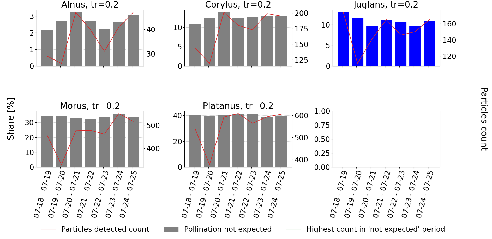

Predictions Mapper
==================

Predictions mapper summarizes particle predictions saved during :doc:`model inference <model_inference>` over user-defined time spans and presents them as plots. The task can be run using ``isep.map_predictions``.

Input
-----

The predictions file is given in ``file_to_process_rel_path``, relative to the *resources* directory, e.g. the combined file produced by inference. Each particle is assigned to the class with the highest probability, as long as the probability reaches the threshold. A single threshold for all classes is set with ``thresholds.threshold``. Alternatively, with ``thresholds.threshold_type`` set to ``CLASS_THRESHOLD``, a separate threshold for every class is read from the JSON file given in ``thresholds.per_type_thresholds_path``, e.g. ``{"Alnus": 0.6, "Corylus": 0.5}``.

Particles are summed within time spans defined by ``split_timespan.days``, ``hours``, ``minutes`` and ``seconds`` (7 days by default). The processed period can be limited with ``split_timespan.range_from`` and ``split_timespan.range_to``. Duplicated timestamps are removed before summing.

For quick preview of large files, ``preview.keep_every_nth_row`` allows processing only every n-th row.

Output
------

Summed particle counts of every time span are saved as a *.csv* file in ``save_path_rel_path`` (*resources\\predictionsMapper\\out* by default), named ``tr_<threshold>_of_<predictions file name>.csv``. Every row holds the start and the end of the time span and the number of particles of every class.

Results can be presented as a bar plot or a line plot, selected with ``plot_settings.plot_style``:

.. code-block:: text

   Plots
   ├── Bar plot (BAR_STYLE_PLOT)
   │   ├── Percentage share of classes in the time span (PERCENTAGE_SHARE_IN_TIMESPAN)
   │   ├── Particles per cubic meter (P_PER_M_CUBE)
   │   ├── Grid with a separate plot for every class (display_as_grid)
   │   └── Expected pollen season months (is_months_of_expectance)
   └── Line plot (LINE_STYLE_PLOT)
       ├── Particles per cubic meter (P_PER_M_CUBE)
       └── Particle count (COUNT)

Concentration in particles per cubic meter is calculated from the particle count and the air volume sampled by Rapid-E during the time span, assuming the flow rate of 2.8 l/min. With ``bar_plot_settings.is_months_of_expectance`` enabled, the JSON file given in ``months_of_expectance_mapping_path`` defines the months in which every pollen type is expected, e.g. ``{"Alnus": [1, 2, 3]}``. The highest count outside of the expected months is then marked on the plot as a reference level of false detections.

Running predictions mapper
~~~~~~~~~~~~~~~~~~~~~~~~~~

The following example summarizes the predictions of the inference example in daily time spans and presents the concentration of particles per cubic meter as a grid of bar plots.

.. code-block:: python

   import isep
   from isep.configs import PredictionsMapperConfig
   from isep.configs.predictionsMapper import (
      SplitTimespanModel,
      ThresholdsModel,
      PlotSettingsModel,
      BarPlotSettingsModel,
   )

   if __name__ == "__main__":
      isep.map_predictions(
         PredictionsMapperConfig(
               file_to_process_rel_path="modelRunner/out/tr_0_demo3.csv",
               split_timespan=SplitTimespanModel(days=1),
               thresholds=ThresholdsModel(threshold=0.5),
               plot_settings=PlotSettingsModel(
                  plot_style=PlotSettingsModel.BAR_STYLE_PLOT,
                  bar_plot_settings=BarPlotSettingsModel(
                     plot_type=BarPlotSettingsModel.PARTICLES_PER_METER_CUBED,
                     display_as_grid=True,
                  ),
               ),
         )
      )

   Daily concentration of particles per cubic meter

.. code-block:: text
   :class: scrollable-code

   2026-11-14 12:09:14,608 - root - INFO - Logging in: '<root>/ISEP/resources/predictionsMapper/logs/20261114.log'
   2026-11-14 12:09:14,609 - predictionsMapper - INFO - Python version='3.11.4 (main, Jul  5 2023, 13:45:01) [GCC 11.2.0]'. (Implemented in 3.11.4)
   2026-11-14 12:09:14,610 - predictionsMapper - INFO - Current Python interpreter path: '/home/tomcz/miniconda3/bin/python'
   2026-11-14 12:09:14,610 - predictionsMapper - INFO - Configs cache on save is NOT invalidated
   2026-11-14 12:09:14,610 - root - INFO - Sterted - predictions mapper
   2026-11-14 12:09:14,611 - root - INFO - Detecting particles with threshold=0.2
   2026-11-14 12:09:14,611 - root - INFO - Processing file=<root>/ISEP/resources/modelRunner/out/processed/tr_0_demo3.csv
   2026-11-14 12:09:14,629 - root - WARNING - Processed measurements are constrained between range: from='2022-03-01 00:00:00', to='2022-08-11 23:59:59'
   2026-11-14 12:09:14,735 - root - INFO - Detected particles count = 9672
   2026-11-14 12:09:14,736 - root - INFO - Timespan: 6 day(s), from=2022-07-18 18:54:08, to=2022-07-25 17:32:41
   2026-11-14 12:09:14,739 - root - INFO - Total: 
      Alnus  Corylus  Juglans  Morus  Platanus
   0    261     1211     1052   3271      3877
   2026-11-14 12:10:06,770 - root - INFO - Finished - predictions mapper
   2026-11-14 12:10:06,770 - root - INFO - Process finished with exit code 0

More
----

For the available entry points, see :ref:`python-api-entry-points`. For
implementation details, see :doc:`API Reference <../api_reference>`.